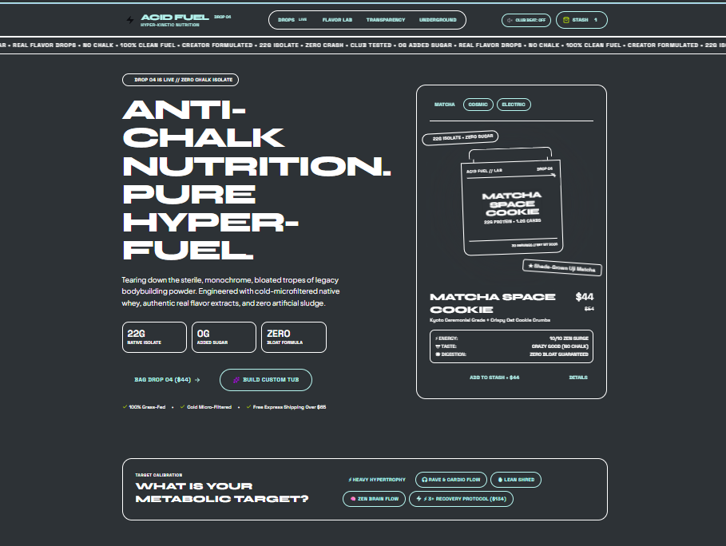
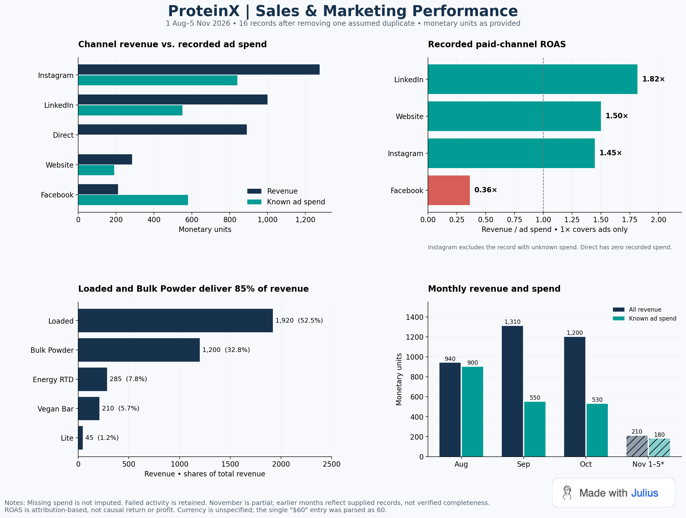
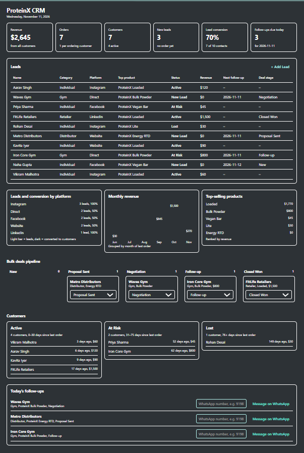

# 🚀 ProteinX | Enterprise AI Business Architecture

## 📌 Project Context & Objective
"ProteinX" is a fictional D2C protein bar brand utilized as a framework to demonstrate the practical application of AI and software engineering within a corporate ecosystem. 

**The Objective:** To architect and deploy an end-to-end, multi-faceted business suite that automates e-commerce operations, standardizes client relationship management (CRM), sanitizes messy marketing data for business intelligence, and integrates custom AI agents for internal workflows.

## 🧰 Tools & Technologies
* **Frontend UI:** React, Tailwind CSS, HTML5, JavaScript
* **Backend & Config:** JSON, System Prompts Architecture
* **Data Analytics (ETL):** Python, Pandas, Matplotlib
* **AI Integration:** Google AI Studio, Claude Artifacts, Julius AI

---

## 📦 Deliverables & Live Demos

### 1. E-Commerce Storefront (`/ProteinX_Ecom_Website`)
* **Deliverable:** Live production URL and responsive UI bundle.
* **Preview:**

### 2. Operational CRM Dashboard (`/CRM_Dashboard`)
* **Deliverable:** Standalone React/Tailwind HTML application.
* **Preview:**

### 3. Sales Data Analytics & BI (`/Sales_Data_Analysis`)
* **Deliverable:** Python ETL sanitization scripts (`analysis.py`) and BI dashboard.
* **Preview:**

### 4. AI Agent Marketplace (`/AI_Agent_Marketplace`)
* **Deliverable:** UI directory grid and backend `agents_config.json` defining 4 distinct AI agents.
* **Preview:**

---

## ✨ Project Highlights & Business Impact
* **Zero-Dependency Dashboards:** Engineered the React CRM dashboard to run directly in the browser as a standalone HTML file, eliminating heavy `node_modules` overhead.
* **Automated Data Sanitization:** Programmed Python pipelines to ingest unstructured CSVs, standardizing string variables and parsing spend data to uncover a **1.82x ROAS efficiency** on LinkedIn.
* **Custom AI Tooling:** Built a centralized internal marketplace containing role-specific AI agents (Sales Lead Finder, Competitor Analyst, Content Research, Resume Optimizer) powered by strict JSON configurations.
* **Responsive UI/UX:** Ensured mobile-first, scalable design architecture across both the consumer e-commerce site and internal corporate tools.

## 🔄 Workflow Architecture
1. **Acquisition:** Customers interact with the deployed e-commerce storefront.
2. **Analysis:** Marketing spend is exported and parsed via the Python data pipeline to calculate Return on Ad Spend (ROAS).
3. **Operations:** High-value clients and at-risk leads are routed to the React CRM Dashboard for daily tracking.
4. **Internal Support:** Employees utilize the AI Agent Marketplace to research competitors, optimize marketing content, and generate new leads based on CRM insights.

## 📂 Repository Structure
<pre>
AI-Business-Solutions-ProteinX/
├── README.md
├── LICENSE
├── ProteinX_Ecom_Website/
│   ├── site_link.txt
│   └── website_preview.png
├── CRM_Dashboard/
│   ├── ProteinX_CRM_Sample_Data.csv
│   ├── crm-dashboard.html
│   └── dashboard_preview.png
├── Sales_Data_Analysis/
│   ├── ProteinX_Sales_Marketing.csv
│   ├── analysis.py
│   └── performance_dashboard.png
└── AI_Agent_Marketplace/
    ├── marketplace.html
    ├── portal_preview.png
    └── agents_config.json
</pre>

## ⚙️ Installation & Usage
1. Clone the repository:
   <pre>git clone https://github.com/coderishani/AI-Business-Solutions-ProteinX.git</pre>
2. **Web & CRM:** Open `CRM_Dashboard/crm-dashboard.html` or `AI_Agent_Marketplace/marketplace.html` directly in any modern web browser. No local server required.
3. **Data Analytics:** Navigate to the analytics directory and execute the Python script (requires Pandas and Matplotlib):
   <pre>cd Sales_Data_Analysis
python analysis.py</pre>

## 🧠 Key Skills Demonstrated
* **Full-Stack Systems Integration & Architecture**
* **Advanced Prompt Engineering & AI Workflow Design**
* **Python Data Cleaning & Transformation (ETL)**
* **UI/UX Prototyping & Frontend Deployment**

## 📈 Learning Outcomes
* Mastered the orchestration of multiple AI platforms (Claude, Google AI Studio, Julius) to generate production-ready code.
* Bridged the gap between raw, messy data and actionable business intelligence by writing custom Python sanitization logic.
* Learned to structure and deploy complex multi-directory GitHub repositories for professional portfolio presentation.

## 🚧 Challenges Faced
* **Data Inconsistencies:** The raw marketing CSV contained duplicate rows, null values, and inconsistent naming conventions. Resolved this by implementing robust string manipulation and mapping functions in Pandas.
* **Agent Hallucinations:** Initial AI agent prompts yielded generic outputs. Overcame this by engineering a strict JSON schema that defined explicit operational constraints, persona boundaries, and formatting rules for each agent.

## 🔮 Future Improvements
* Integrate a PostgreSQL database to replace static CSV files and local JSON configurations.
* Connect the React CRM directly to live API endpoints for real-time lead updates.
* Implement role-based user authentication (RBAC) for the AI Agent Marketplace.

## 📝 Project Note
This repository serves as a comprehensive technical showcase built to demonstrate enterprise-level problem-solving, AI integration, and systems architecture.

---

## 👤 Author
**Ishani Jain**
* B.Tech Computer Science & Information Technology
* GitHub: [@coderishani](https://github.com/coderishani)

⭐ *If you found this repository helpful, consider giving it a star!*
